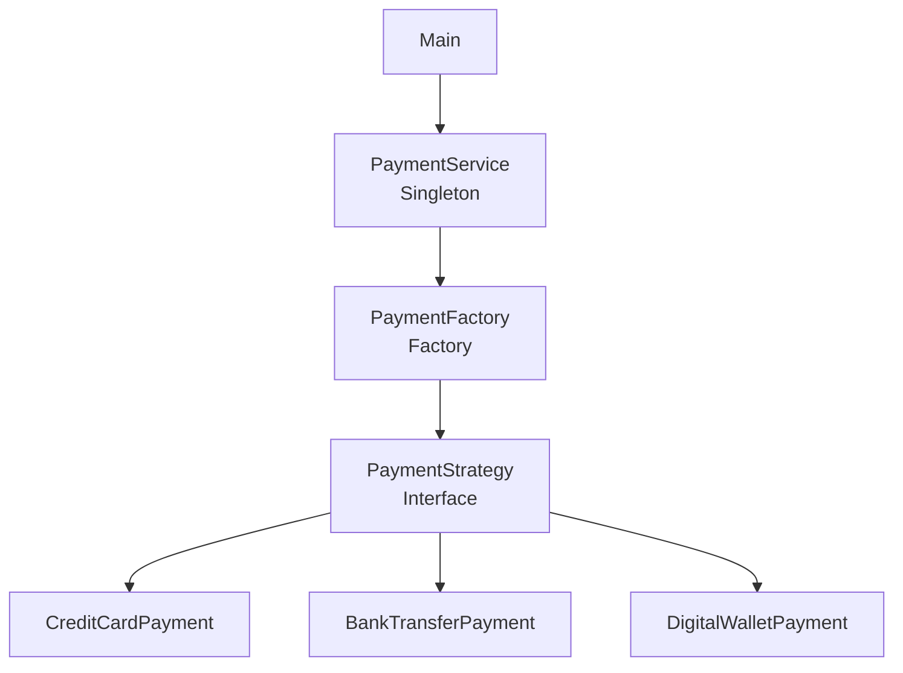

# PaymentDemo

PaymentDemo; kredi kartı, Havale / EFT ve dijital cüzdan ödeme akışlarını konsol üzerinden simüle eden, sade bir Java uygulamasıdır. Proje; nesne yönelimli programlama yaklaşımını ve yaygın tasarım desenlerini küçük, çalıştırılabilir bir örnek üzerinde gösterir.

## Projenin Amacı

Java OOP ve Design Pattern kavramlarını gerçekçi bir ödeme simülasyonu üzerinde uygulamalı olarak öğrenmek ve Singleton, Strategy ile Factory desenlerinin birlikte kullanımını göstermektir.

## Kullanılan Teknolojiler

- Java 21
- Maven
- JUnit 5
- Object-Oriented Programming
- Singleton Pattern
- Strategy Pattern
- Factory Pattern

## Desteklenen Ödeme Yöntemleri

- Kredi kartı
- Havale / EFT
- Dijital cüzdan

## Kullanılan Tasarım Desenleri

### 1. Singleton Pattern

Singleton, bir sınıftan uygulama boyunca yalnızca tek bir nesne oluşturulmasını sağlar. Projede `PaymentService` sınıfı bu deseni kullanır. İç içe `InstanceHolder` sınıfı sayesinde nesne ihtiyaç duyulduğunda oluşturulur; Java'nın sınıf yükleme garantileriyle ek senkronizasyon gerektirmeden thread-safe biçimde paylaşılır. Böylece tüm ödeme talepleri tek bir servis erişim noktası üzerinden yönetilir.

### 2. Strategy Pattern

Strategy, aynı işi farklı yöntemlerle gerçekleştiren algoritmaları ortak bir sözleşme altında toplar. `PaymentStrategy` arayüzü ödeme davranışını tanımlar; `CreditCardPayment`, `BankTransferPayment` ve `DigitalWalletPayment` sınıfları bu davranışı birbirinden bağımsız olarak uygular. Bu tercih, ödeme yöntemine özgü kodun servis katmanından ayrılmasını sağlar.

### 3. Factory Pattern

Factory, kullanılacak somut nesnenin oluşturulmasını merkezi bir noktada toplar. `PaymentFactory`, kendisine verilen `PaymentType` değerine göre uygun `PaymentStrategy` uygulamasını üretir. Böylece `PaymentService`, somut ödeme sınıflarını seçme ayrıntısıyla ilgilenmeden ortak arayüz üzerinden çalışır.

## Proje Mimarisi

```text
PaymentDemo/
├── pom.xml
├── README.md
├── .gitignore
└── src/
    ├── main/java/com/paymentdemo/
    │   ├── Main.java
    │   ├── factory/
    │   │   └── PaymentFactory.java
    │   ├── model/
    │   │   └── PaymentType.java
    │   ├── singleton/
    │   │   └── PaymentService.java
    │   └── strategy/
    │       ├── PaymentStrategy.java
    │       ├── CreditCardPayment.java
    │       ├── BankTransferPayment.java
    │       └── DigitalWalletPayment.java
    └── test/java/com/paymentdemo/
        ├── factory/PaymentFactoryTest.java
        ├── singleton/PaymentServiceTest.java
        └── strategy/PaymentStrategyTest.java
```

Ödeme isteği `Main` sınıfından alınır ve Singleton `PaymentService` nesnesine iletilir. Servis tutarı doğruladıktan sonra `PaymentFactory` aracılığıyla seçilen türe uygun stratejiyi oluşturur. Ödeme, ortak `PaymentStrategy` arayüzü üzerinden ilgili somut sınıf tarafından simüle edilir.



## Uygulamanın Çalışma Mantığı

1. `Main`, desteklenen ödeme yöntemlerini konsolda listeler.
2. Kullanıcı bir ödeme yöntemi seçer ve ödeme tutarını girer.
3. Menü seçimi bir `PaymentType` değerine dönüştürülür.
4. `PaymentService`, tutarın boş olmadığını ve sıfırdan büyük olduğunu doğrular.
5. `PaymentFactory`, ödeme türüne uygun `PaymentStrategy` nesnesini oluşturur.
6. Seçilen stratejinin `pay` metodu çalışır ve başarılı ödeme mesajı konsola yazılır.
7. Geçersiz seçimler, sayısal olmayan tutarlar, sıfır ve negatif tutarlar kullanıcıya açıklayıcı mesajlarla bildirilir.

## Konsol Örneği

```text
===== PAYMENT DEMO =====
1 - Kredi Kartı
2 - Havale / EFT
3 - Dijital Cüzdan
0 - Çıkış
Seçiminiz: 1
Ödeme tutarı (TL): 500
Kredi kartı ile 500 TL ödeme başarılı.
```

## Kurulum ve Çalıştırma

Gereksinimler:

- JDK 21
- Maven 3.9 veya üzeri

Projeyi GitHub üzerinden indirdikten sonra terminalde proje dizinine geçin ve aşağıdaki komutları çalıştırın:

```bash
mvn clean compile
mvn test
java -cp target/classes com.paymentdemo.Main
```

Windows PowerShell veya Komut İstemi'nde de proje kök dizininden aynı komutlar kullanılabilir:

```powershell
mvn clean compile
mvn test
java -cp target\classes com.paymentdemo.Main
```

## Testler

Proje toplam **11 JUnit 5 testi** içerir. Testler:

- Factory'nin üç ödeme türü için doğru Strategy sınıfını oluşturmasını,
- null ödeme türünün reddedilmesini,
- Singleton erişimlerinin aynı `PaymentService` nesnesini döndürmesini,
- pozitif tutarın işlenmesini,
- sıfır ve negatif tutarların reddedilmesini,
- her ödeme stratejisinin beklenen başarı mesajını üretmesini

kontrol eder. Güncel Maven test çalıştırmasında 11 testin tamamı başarılıdır.

## Plug and Play Mantığı

Yeni bir ödeme yöntemi eklemek için mevcut mimari genişletilebilir. Örneğin QR ödeme desteği için:

1. `PaymentStrategy` arayüzünü uygulayan `QrPayment` sınıfı oluşturulur.
2. `PaymentType` enum'una `QR_PAYMENT` değeri eklenir.
3. `PaymentFactory` içindeki `switch` ifadesine bu türü `QrPayment` nesnesiyle eşleyen bir durum eklenir.
4. Konsoldan seçilebilmesi isteniyorsa `Main` sınıfındaki menü ve `paymentTypeFrom` eşlemesi güncellenir.
5. Factory ve Strategy davranışları için ilgili JUnit testleri eklenir.

Bu proje otomatik eklenti keşfi yapmaz; yeni bir ödeme yöntemi yukarıdaki açık genişletme noktalarına kod eklenerek sisteme dahil edilir.

## Proje Hakkında

PaymentDemo, Java ile nesne yönelimli programlama ve tasarım desenlerini öğrenmek amacıyla geliştirilmiş bir eğitim projesidir. Uygulama yalnızca ödeme sürecini konsolda simüle eder; gerçek para transferi gerçekleştirmez ve herhangi bir ödeme kuruluşuyla bağlantı kurmaz.
